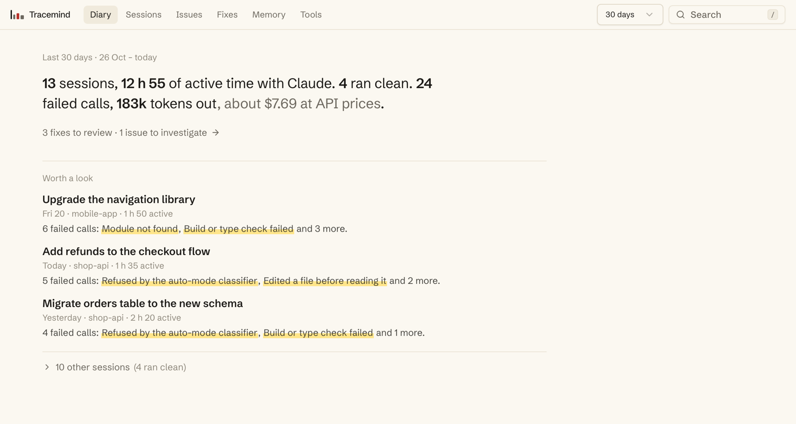

<p align="center"></p>

<h1 align="center">Tracemind</h1>

<p align="center">See what goes wrong in your Claude Code sessions, and fix it.</p>



Tracemind reads your Claude Code sessions on your machine. It tells you how the week went, names
what keeps failing (refused commands, files edited before they were read, builds that break), and
suggests a fix to your Claude setup that you can apply, undo, and check later.

## Try it

```bash
git clone https://github.com/SamBagetAI/tracemind && cd tracemind
pnpm install && pnpm build && npm link
tracemind setup claude-code   # records every new session
tracemind import              # loads the last 30 days
tracemind ui                  # opens http://localhost:4545
```

Needs Node 22.13 or later. Your data stays in `~/.tracemind` unless you link a shared server.

## Ask Claude about it

```bash
tracemind setup mcp
```

Then ask Claude "what keeps going wrong in this repo?" or "show me the fix for the refused commands".

## More

The [guide](docs/guide.md) covers the shared server for a team, routines, every MCP tool, how fixes
work, what counts as an issue, and privacy. Try the UI on made-up data with `scripts/demo.mjs`.

MIT license.
